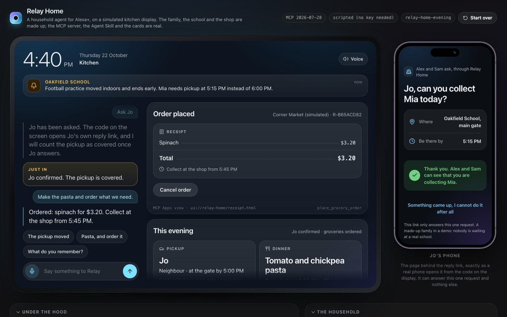
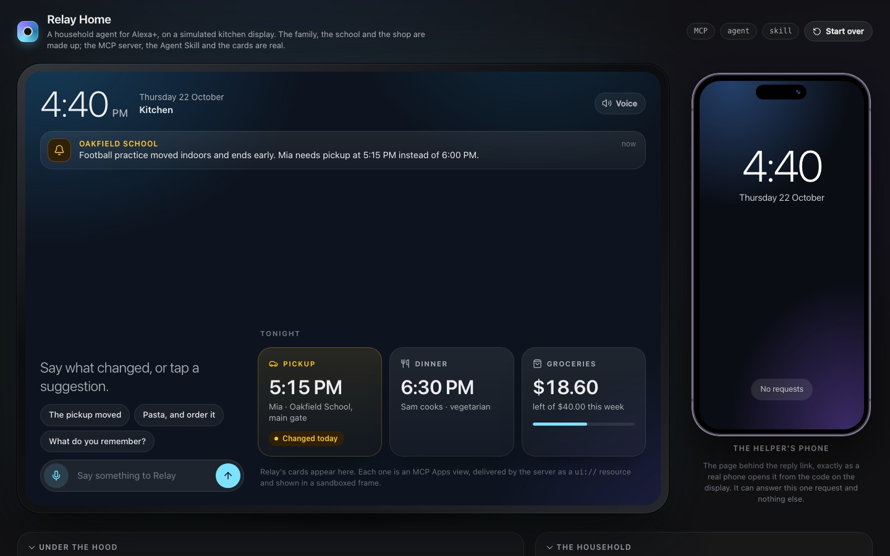
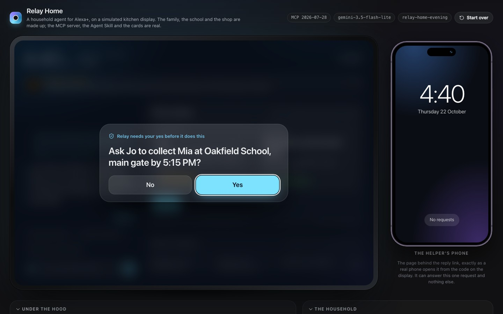
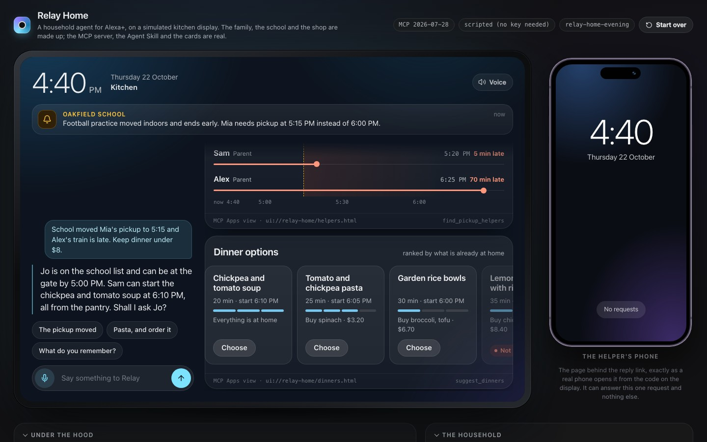
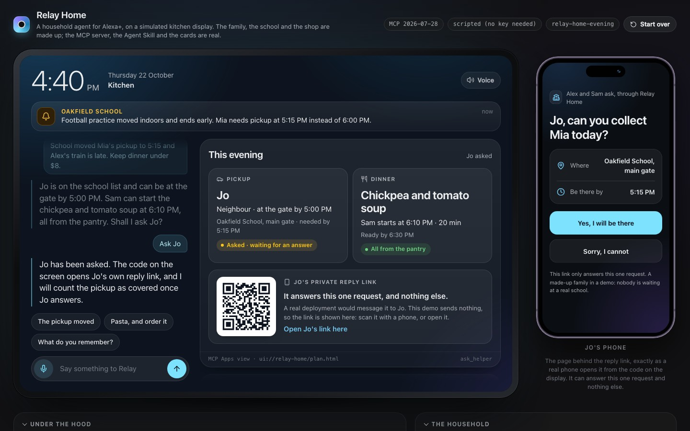

# Relay Home

**A changed pickup time should not derail the whole evening.** Relay Home is a household agent for Alexa+ that
rebuilds an evening after a change of plan: it works out who is allowed and able to collect the child, picks a dinner
that fits the pantry and the budget, and then asks before it requests anything from a person or spends any money.
The adult it asks answers for themselves, on their own phone, through a link that can do nothing else.

It is four things that work together:

- a **self-hosted MCP server** over Streamable HTTP (protocol revision 2026-07-28, and still serving 2025-11-25 clients),
- an **Agent Skill** that tells an agent how to use it,
- a **simulated Alexa+ experience** in the browser: a kitchen display with voice, the server's **MCP Apps** cards on
  its screen, the helper's phone beside it, and a panel that lists every MCP call the agent makes,
- a **second host built with the Strands Agents SDK** (AWS's open-source agent framework), in
  [`integrations/strands/`](integrations/strands/): the same skill and server driven from a terminal, with the
  confirmations answered through the protocol.

> **What is real and what is not.** The MCP server, the protocol traffic, the confirmation flow, the cards and the
> skill are real and run on your machine. The household, the school notice and the shop ("Corner Market") are made
> up. No message is sent to anyone and no money moves. The Alexa+ preview tools are not open to hackathon
> participants, so this has **not** been run on Alexa+; the browser page stands in for it, as the hackathon FAQ allows.

**Try it in the browser:** <https://relay-home.onrender.com> (a free instance: the first load can take up to a minute
while it wakes; the agent there is Gemini 3.5 Flash-Lite when its quota allows, and the built-in scripted model takes the
turn whenever it does not answer; the label at the top of the page says which one did). **Demo video:** <https://youtu.be/EhCnOVfZsgE> (2:21, on the 2.3 interface: a person talks to the display and Relay answers aloud, Jo answers from their own phone, and a line of dominoes falls and stands up again; the agent in it is Gemini 3.5 Flash-Lite). The file and its captions are also on the [`media` branch](https://github.com/yy5652-hash/relay-home/tree/media);
[`docs/demo-video.md`](docs/demo-video.md) says how it was recorded and reproduces the conversation in it.



## Run it

Needs Node.js 22.9 or later and pnpm. Settings are optional; copy `.env.example` to `.env` to change any.

```bash
pnpm install
pnpm start
```

Open <http://localhost:4317>. No key and no account are needed.
The display starts at rest with tonight's three facts (the pickup, dinner, what is left of the
grocery cap), read through `get_household`; the phone beside it is asleep.



Then try this, in order:

1. Click **The pickup moved**. Relay reads the household, checks helpers and dinners in parallel, and drafts a plan.
   Three cards appear on the screen; *Under the hood*, below the display, lists the four MCP calls behind them.
   Scroll the cards: *Who can collect Mia* draws every adult's arrival against the 5:15 deadline, to scale.
2. Click **Ask Jo** inside the card. Relay's question covers the display. Say **Yes**.
   The card now reads "Asked · waiting for an answer" and shows Jo's private reply link as a code. A real
   deployment would message that link to Jo; this demo sends nothing, so the display shows it. Relay does not
   call the pickup covered.
3. The phone beside the display has woken as *Jo's phone*, showing what the code opens. Tap **Yes, I will be there** on it
   (you are playing Jo; on the hosted copy you can scan the code with a real phone instead). Within a few seconds
   the display says "Just in · Jo confirmed" and the card changes to "Confirmed from their phone".
4. Click **Pasta, and order it**. Relay prices the missing spinach, asks you to confirm $3.20, and places the order.
   A receipt card appears, with the week's grocery cap moving from what was left to what is left now, and the
   evening card updates itself.
5. Ask **What do you remember?**, then reload the page: the evening card is back on the display, because the
   household is kept between sessions.

Other things worth trying: on Jo's phone, tap **Something came up** after confirming (the display announces it, and
with nobody else on the school list in time the plan stops and names no one); turn on **Voice** (in Chrome),
press the microphone and say what changed: the words appear as you say them, Relay speaks its answers, reads each
confirmation out and listens for your yes or no; say "No" on a confirmation sheet (nothing happens, and the server does not put the question again);
"Jo can't make it" (Jo is left out, and with nobody else eligible the plan is blocked and names no one);
"Keep dinner under $2 and 20 minutes"; "Set the weekly cap to $22" and then try to order.

Run the tests with `pnpm test` (37 tests: the rules, the MCP server in memory, the real HTTP endpoint on both protocol
revisions, the helper's reply link, the agent, the model adapters).

## Host it

`render.yaml` describes one free web service on Render, built from the `Dockerfile` (health check `/api/health`).
The server answers only to its own public name, which Render passes in `RENDER_EXTERNAL_HOSTNAME`; elsewhere set
`HOST=0.0.0.0`, `RELAY_ALLOWED_HOSTS=your.host.name` and `RELAY_PUBLIC_URL=https://your.host.name` (the address
reply links are built on; Render's own is used there). A free instance sleeps when idle and has no disk, so the
demo households start fresh after a restart. Without a model key the hosted page runs the scripted model; with
`GEMINI_API_KEY` set as an environment variable it runs Gemini. Our own copy runs at <https://relay-home.onrender.com>
with a Gemini key, and its MCP endpoint is `https://relay-home.onrender.com/mcp`.

## Drive it from a Strands agent

[`integrations/strands/relay_agent.py`](integrations/strands/relay_agent.py) connects a Strands agent (Python) to
the same endpoint with the same Agent Skill. Strands negotiates the 2026-07-28 revision and drives Relay's
`input_required` confirmations itself, through an elicitation callback that asks the person at the terminal.
See [its README](integrations/strands/README.md) for how to run it and a recorded transcript.

## See a yes on the wire

`pnpm wire` (or `node scripts/wire.mjs`) starts a server with a throw-away household, asks Jo, and prints every HTTP
exchange with `/mcp` on the way, with its timing. `pnpm wire no` shows the same with a person who declines.

```
── exchange 1 ── POST /mcp ── 200 in 4.8 ms
→ {"method":"tools/call","name":"ask_helper","arguments":{"name":"Jo"}}
← {"resultType":"input_required","inputRequests":{"confirm":{"method":"elicitation/create","message":"Ask Jo to collect Mia at Oakfield School, main gate by 5:15 PM?"}},"requestState":"eyJkbyI6ImFzayIsIm…(94 chars)"}

   the person is asked: "Ask Jo to collect Mia at Oakfield School, main gate by 5:15 PM?"  →  yes

── exchange 2 ── POST /mcp ── 200 in 3.4 ms
→ {"method":"tools/call","name":"ask_helper","arguments":{"name":"Jo"},"inputResponses":{"confirm":{"action":"accept","content":{"confirm":true}}},"requestState":"eyJkbyI6ImFzayIsIm…(94 chars)"}
← {"resultType":"complete","text":"Confirmed and done: the request to Jo is recorded, …","request":{"id":"P-5B78C254","name":"Jo","status":"awaiting reply","replyUrl":"http://127.0.0.1:51033/r/wAoGlWdFSQT8"},"done":true}

── the helper's phone ── POST /api/reply/‹code› ── in 2.3 ms
→ {"accepted":true}
← {"helper":"Jo","child":"Mia","where":"Oakfield School, main gate","by":"5:15 PM","from":"Alex and Sam","status":"confirmed"}
```

The first call is not carried out: it comes back as a question and a sealed state. Only the second call, which
carries the person's answer and that state, does anything. With "no", the second answer is `"done": false` and no
request exists afterwards. The demo film draws this exchange as its second figure.

## Connect your own MCP client

The endpoint is `http://localhost:4317/mcp`. Each visitor gets their own household and a bearer token for it:

```bash
curl -s -X POST http://localhost:4317/api/session -H 'content-type: application/json' -d '{}'
```

Use the returned `token` as `Authorization: Bearer <token>`. Any MCP client that speaks Streamable HTTP can list and
call the tools, for example:

```bash
curl -s -X POST http://localhost:4317/mcp \
  -H "authorization: Bearer $TOKEN" -H 'content-type: application/json' \
  -H 'accept: application/json, text/event-stream' \
  -d '{"jsonrpc":"2.0","id":1,"method":"tools/call","params":{"name":"get_household","arguments":{}}}'
```

## The tools

| Tool | What it does | Changes anything? | Card |
|---|---|---|---|
| `get_household` | The notice, the pickup list, dinner slot, pantry, memory, open requests, orders | no | |
| `find_pickup_helpers` | Checks every adult against the school list, their calendar and travel time, with reasons | no | helpers |
| `suggest_dinners` | Ranks meals by pantry coverage within time, diet and what is left of the weekly cap | no | dinners |
| `draft_evening_plan` | Puts pickup and dinner into one stored draft | draft only | evening |
| `ask_helper` | Records a pickup request to an eligible person and makes their private reply link | **needs a yes** | evening |
| `record_helper_reply` | Stores an answer the household passes on; a "no" removes them from today's plans | yes | evening |
| `withdraw_pickup_request` | Takes back an unanswered request | **needs a yes** | evening |
| `quote_groceries` | Prices the missing items; returns a signed ten-minute quote | no | |
| `place_grocery_order` | Buys exactly the quoted items | **needs a yes** | receipt |
| `cancel_grocery_order` | Cancels an order and returns the amount to the cap | **needs a yes** | receipt |
| `update_preferences` | Changes the diet preference or the weekly grocery cap | **needs a yes** | |
| `confirm_action` | Redeems a confirmation ticket (for clients that cannot be asked directly) | **needs a ticket** | |

## How the parts work

**Rules live in the server, not in the model.** Only someone on the school pickup list who can arrive in time may be
asked. With nobody eligible the plan is blocked and names no one. A pickup is "awaiting reply" until the helper
answers. An order must match a quote the server signed (HMAC), for the exact total, within the weekly cap, and a
repeated call with the same `orderKey` returns the same order instead of buying twice. An agent that ignores the skill
still cannot get past these; `test/` exercises each of them.



**Confirmation happens inside the protocol.** Every tool that does something for the household (asking a helper,
taking a request back, buying, cancelling an order, changing the weekly cap) first answers `input_required`
with a question for the person (the multi-round-trip pattern of the 2026-07-28 revision). The client shows the
question, and the retried call carries the answer together with the state the server sealed, so a yes cannot be
replayed for a different action. An answer that is not a yes ends the call with `done: false`. A 2025-11-25 client on
a stateless connection cannot be asked this way, so it receives a sealed five-minute ticket and redeems it with
`confirm_action` after the person agrees. Both paths run the same code once confirmed. See `src/mcp/server.js`.

**Cards are MCP Apps views.** Tools point at `ui://relay-home/*.html` resources. The simulator page is a real MCP Apps
host: it reads the resource from the server, puts it in a sandboxed frame, and talks to it through `AppBridge`.
A tap on a card does not act; it sends a message into the conversation, so every action still goes through the agent
and the confirmation. The evening card reads the household through the host every few seconds (read-only tools only),
which is how it shows "Confirmed" or "Ordered" without a new card. When the host itself learns of a change (a
helper's answer), it does not wait for that: MCP Apps has no "your data is stale" signal, so the host sends the
evening card a fresh tool result. See `web/view.js`, `web/host.js`, `src/mcp/views.js`.



**A card shows the rule, not only the result.** The helpers card draws each adult's arrival on one time axis with
the deadline as a line, so "Lee would be first but is not on the school's list" and "Sam is five minutes late" are
visible at a glance; the data is the tool's own `structuredContent`. Cards carry no look of their own beyond a
fallback: they read the MCP Apps host style variables (`--color-background-primary`, `--font-sans`,
`--border-radius-md` and the rest) that the host passes in `hostContext.styles.variables`, so the same card sits
natively in the simulator's dark display and falls back to its own light or dark palette in any other host.

**The helper answers for themselves.** A pickup needs two people to agree: the parent who asks and the adult who
goes. When the parent says yes, `ask_helper` returns a reply link with a random twelve-character code. The evening
card draws it as a QR code (a 130-line encoder in `src/domain/qr.js`, no dependency, checked against a real scanner).
The page behind it (`public/reply.html`) shows that one question and takes one answer; it cannot read the household
and needs no account. The answer lands in the same server rule as `record_helper_reply`, so a "no" draws the plan
again. Because it arrives outside the conversation, the display announces it, and the agent is told in a note
before the person's next message. A helper who said yes can still drop out; a no is final for the day.
Relay does not send the link in this demo: the display shows it, and the simulator puts Jo's phone beside it.
See `src/http.js` (`/api/reply`), `src/domain/actions.js` (`answerRequest`).



**The agent follows an Agent Skill.** `skills/relay-home-evening/` is a skill in the agentskills.io layout
(`SKILL.md` with front matter, plus references). The simulator's agent loads it as its instructions and reaches the
household only through the MCP endpoint, over HTTP, with the visitor's own token. See `src/agent/`.

**Which model drives the agent.** By default a small scripted model follows the skill, so the project runs without a
key and behaves the same every time. Set `GEMINI_API_KEY`, or `LLM_API_KEY` + `LLM_BASE_URL` + `LLM_MODEL` for any
OpenAI-compatible service, and a hosted model takes its place with the same skill and tools (see `.env.example`).
A request the model service has not answered within 3 s is sent a second time and the first answer is used, which
keeps a slow moment of the service from becoming a slow turn; a service that is briefly overloaded is asked again,
twice. If the hosted model still does not answer, or refuses (quota, a bad key), the scripted one takes that turn
and the page says so. Both adapters are tested against each service's wire format with a stand-in for the network,
and the Gemini one drives the hosted copy (`gemini-3.5-flash-lite`).

**State across sessions.** Each household is one JSON file under `.data/`, written atomically. The token is the
sealed household id; the page keeps it in the browser, so a reload or a second MCP client sees the same evening.

## Layout

```
src/domain/     the household, the planner, the actions and their rules, the store, the QR encoder
src/mcp/        the MCP server (12 tools) and the ui:// views
src/agent/      the agent loop, the skill loader, the scripted model, the hosted-model adapters
src/http.js     /mcp behind bearer auth, the chat stream, the endpoints the page uses
skills/         the Agent Skill
integrations/   a second host: the Strands agent (Python)
web/            source of the card code and of the page's host code (bundled by `pnpm build`)
public/         the simulator page (the display, the phone beside it) and reply.html (the helper's page)
test/           37 tests
scripts/        the bundler, and `wire.mjs`: the consent round trip printed as it travels
docs/           product feedback and friction log, submission text
```

`dist/view.js` and `public/host.js` are build outputs that are committed, so running needs no build step.

## Licence

MIT. Dependencies: the MCP TypeScript SDK packages and `@modelcontextprotocol/ext-apps` (MIT), Express (MIT), Zod (MIT).
The interface reuses Radix Colors (MIT), Lucide icons (ISC), Open Props easings (MIT) and the Devices.css phone frame
(MIT), copied in as values with nothing loaded at run time; see [`THIRD_PARTY_NOTICES.md`](THIRD_PARTY_NOTICES.md).
AI coding assistance was used to write this project.
